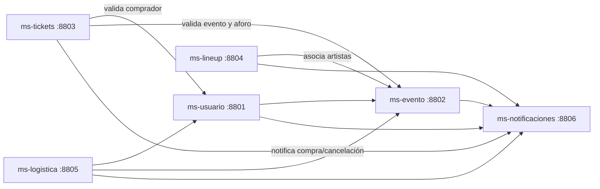

# 🎪 Festival Microservicios

Plataforma de gestión de festivales construida con **arquitectura de microservicios**: usuarios, eventos, venta de tickets, line-up de artistas, logística y notificaciones, cada uno desplegado en su propio contenedor Docker y con su propia base de datos en Oracle Cloud.

> Proyecto académico — **DSY1103 Desarrollo Fullstack I**, Duoc UC.


---

## 📑 Tabla de contenidos

1. [Arquitectura](#-arquitectura)
2. [Microservicios](#-microservicios)
3. [Comunicación entre servicios](#-comunicación-entre-servicios)
4. [Stack tecnológico](#-stack-tecnológico)
5. [Diseño interno por capas](#-diseño-interno-por-capas)
6. [ms-tickets en detalle](#-ms-tickets-en-detalle)
7. [HATEOAS](#-hateoas)
8. [Pruebas](#-pruebas)
9. [Ejecución con Docker](#-ejecución-con-docker)
10. [Documentación de la API (Swagger)](#-documentación-de-la-api-swagger)
11. [Seguridad](#-seguridad)
12. [Estructura del repositorio](#-estructura-del-repositorio)
13. [Problemas frecuentes](#-problemas-frecuentes)
14. [Autores](#-autores)

---

## 🏗 Arquitectura

Seis servicios independientes que se comunican por HTTP. Cada uno es dueño exclusivo de sus datos: **ningún servicio lee tablas de otro**; si necesita información ajena, la pide por la API del servicio correspondiente.



## 🧩 Microservicios

| Servicio | Puerto | Responsabilidad |
|---|:---:|---|
| `ms-usuario` | 8801 | Registro, autenticación y roles. Emite los tokens JWT. |
| `ms-evento` | 8802 | Gestión de eventos del festival (estado y aforo). |
| `ms-tickets` | 8803 | Compra, consulta, validación por QR y cancelación de entradas. |
| `ms-lineup` | 8804 | Artistas y programación del festival. |
| `ms-logistica` | 8805 | Recursos y logística del evento. |
| `ms-notificaciones` | 8806 | Registro y envío de notificaciones a usuarios. |

## 🔗 Comunicación entre servicios

La comunicación usa **OpenFeign** (clientes HTTP declarativos). Las URLs se inyectan por variables de entorno en `docker-compose.yml`, usando el nombre del servicio como host (dentro de Docker `localhost` no sirve entre contenedores).

| Origen | Destino | Para qué |
|---|---|---|
| `ms-tickets` | `ms-usuario` | Verificar que el comprador existe y está activo |
| `ms-tickets` | `ms-evento` | Verificar que el evento está `PUBLICADO` y obtener el aforo máximo |
| `ms-tickets` | `ms-notificaciones` | Notificar compra y cancelación (si falla, la compra no se revierte) |
| `ms-lineup` | `ms-evento` | Asociar artistas a un evento existente |
| `ms-logistica` | `ms-usuario`, `ms-evento` | Coordinar recursos según evento y responsables |

## 🛠 Stack tecnológico

| Área | Tecnología |
|---|---|
| Lenguaje y framework | Java 17, Spring Boot 3.4 |
| Persistencia | Spring Data JPA / Hibernate |
| Base de datos | Oracle Cloud ATP (conexión con Wallet) |
| Seguridad | Spring Security + JWT (jjwt 0.12.6) |
| Comunicación | Spring Cloud OpenFeign |
| API REST | Spring Web, Bean Validation, **Spring HATEOAS** |
| Documentación | Springdoc OpenAPI (Swagger UI) |
| Pruebas | JUnit 5, Mockito, MockMvc, Spring Security Test |
| Contenedores | Docker y Docker Compose |
| Utilidades | Lombok, Maven Wrapper |

## 🧱 Diseño interno por capas

Todos los microservicios siguen la misma separación de responsabilidades:

```
controller/   Recibe HTTP y delega. No contiene lógica de negocio.
service/      Reglas de negocio. Trabaja con DTOs, nunca con la entidad en la API.
repository/   Único punto de acceso a Oracle (JpaRepository).
dto/          Objetos de entrada y respuesta (la entidad JPA no se expone).
model/        Entidades JPA.
mapper/       Conversión entidad <-> DTO.
client/       Clientes Feign hacia otros microservicios.
security/     Filtro JWT y utilidades de token.
exception/    Excepciones de negocio + manejador global.
assembler/    (HATEOAS) Construye los enlaces de cada respuesta.
```

Beneficio: si cambia la base de datos solo se toca `repository`; si cambia el protocolo de entrada solo se toca `controller`; el `service` no cambia.

## 🎟 ms-tickets en detalle

### Reglas de negocio de la compra

`comprarTicket` valida, en este orden:

1. El **usuario** existe y está activo.
2. El **evento** está en estado `PUBLICADO`.
3. Hay **aforo disponible** (tickets `COMPRADO` + `USADO` < aforo máximo del evento).
4. El usuario **no tiene ya** un ticket del mismo tipo para ese evento.

Si todo pasa: se genera un **código QR único (UUID)**, se guarda el ticket en estado `COMPRADO` y se envía una notificación.

### Ciclo de vida del ticket

```
COMPRADO ──validar QR──▶ USADO
    │
    └──cancelar──▶ CANCELADO
```

- Solo se puede **cancelar** un ticket en estado `COMPRADO`.
- Un ticket `USADO` no puede validarse de nuevo; uno `CANCELADO` no es válido.

### Endpoints

Existen dos versiones del controlador con la misma funcionalidad:

- **V1** `/api/tickets` → respuestas JSON simples.
- **V2** `/api/v2/tickets` → respuestas con enlaces HATEOAS.

| Método | Ruta (V1) | Descripción | Éxito |
|---|---|---|:---:|
| `POST` | `/api/tickets` | Comprar un ticket | 201 |
| `GET` | `/api/tickets/{id}` | Obtener un ticket por ID | 200 |
| `GET` | `/api/tickets/usuario/{usuarioId}` | Tickets de un usuario | 200 |
| `GET` | `/api/tickets/evento/{eventoId}` | Tickets de un evento | 200 |
| `PUT` | `/api/tickets/validar/{codigoQR}` | Validar entrada con QR | 200 |
| `PUT` | `/api/tickets/cancelar/{id}` | Cancelar un ticket | 200 |

### Respuestas de error

| Situación | Excepción | HTTP |
|---|---|:---:|
| Ticket / QR no encontrado, o ticket cancelado al validar | `TicketNoEncontradoException` | 404 |
| Evento no publicado | `EventoNoDisponibleException` | 422 |
| Aforo agotado | `AforoAgotadoException` | 409 |
| Ticket duplicado | `TicketDuplicadoException` | 409 |
| Ticket ya usado / cancelación no permitida | `TicketYaUsadoException` | 409 |

### Ejemplo de compra

`POST /api/tickets`

```json
{
  "usuarioId": 4,
  "eventoId": 1,
  "tipoEntrada": "GENERAL",
  "precioPagado": 15000
}
```

Respuesta `201 Created`:

```json
{
  "id": 1,
  "usuarioId": 4,
  "eventoId": 1,
  "tipoEntrada": "GENERAL",
  "codigoQr": "b7d1c2e0-...",
  "estado": "COMPRADO",
  "precioPagado": 15000,
  "fechaCompra": "2026-06-23T18:21:03",
  "fechaValidacion": null
}
```

## 🔗 HATEOAS

La **V2** de `ms-tickets` devuelve, además de los datos, los enlaces a las acciones disponibles sobre el recurso. El cliente puede navegar la API sin conocer las URLs de memoria.

`GET /api/v2/tickets/1`

```json
{
  "id": 1,
  "tipoEntrada": "GENERAL",
  "estado": "COMPRADO",
  "_links": {
    "self":              { "href": "/api/v2/tickets/1" },
    "ticketsPorUsuario": { "href": "/api/v2/tickets/usuario/4" },
    "ticketsPorEvento":  { "href": "/api/v2/tickets/evento/1" },
    "validarEntrada":    { "href": "/api/v2/tickets/validar/b7d1c2e0-..." },
    "cancelar":          { "href": "/api/v2/tickets/cancelar/1" }
  }
}
```

**Cómo está implementado**

- `TicketAssembler` implementa `RepresentationModelAssembler`. Su única responsabilidad es convertir un `TicketRespuestaDTO` en un `EntityModel` con sus enlaces.
- Los enlaces se construyen con `linkTo(methodOn(...))`: apuntan a métodos reales del controlador, así que si cambia una ruta los enlaces se actualizan solos.
- Las listas se devuelven como `CollectionModel`, con un enlace `self` y otro `comprarTicket`.
- El controlador no sabe cómo se arman los enlaces: solo delega en el assembler.

## ✅ Pruebas

Las pruebas unitarias no usan base de datos ni red: las dependencias se reemplazan con **Mockito**.

| Tipo de prueba | Herramientas | Qué verifica |
|---|---|---|
| Controlador | `@WebMvcTest`, `MockMvc`, `@MockBean`, `@WithMockUser` | Rutas, códigos HTTP y JSON de respuesta (**24 pruebas**) |
| Servicio | `@Mock`, `@InjectMocks` | Reglas de negocio y excepciones, con repositorio y clientes Feign simulados |
| Datos de prueba | `TicketTestDataFactory` | Fábrica de DTOs, entidades y respuestas falsas reutilizables |

Detalles de las pruebas del controlador:

- `@AutoConfigureMockMvc(addFilters = false)` desactiva el filtro JWT para probar solo la capa web.
- Cubren los seis endpoints, casos exitosos y cada excepción de negocio.
- Se usa el patrón **Given / When / Then** y `verify(...)` para comprobar las llamadas al servicio.

Ejecutar:

```bash
cd ms-tickets
./mvnw test
```

En PowerShell (Windows):

```powershell
.\mvnw.cmd test
```

Resultado esperado: `Tests run: 24, Failures: 0, Errors: 0`.

## 🐳 Ejecución con Docker

### Requisitos

- Docker Desktop en ejecución
- El **Wallet de Oracle Cloud** (archivos de conexión a la base de datos)

### Pasos

1. Clonar el repositorio:

   ```bash
   git clone https://github.com/KevinYulianG/Festival-microservicios.git
   cd Festival-microservicios
   ```

2. Copiar el contenido del Wallet en la carpeta `wallet/` de cada microservicio.
   > El Wallet **no se incluye en el repositorio** por seguridad.

3. Levantar todo el sistema:

   ```bash
   docker-compose up --build
   ```

4. Verificar que los 6 contenedores estén `running` en Docker Desktop o con:

   ```bash
   docker-compose ps
   ```

Para detener y eliminar los contenedores:

```bash
docker-compose down
```

### Puertos expuestos

| Servicio | URL local |
|---|---|
| ms-usuario | http://localhost:8801 |
| ms-evento | http://localhost:8802 |
| ms-tickets | http://localhost:8803 |
| ms-lineup | http://localhost:8804 |
| ms-logistica | http://localhost:8805 |
| ms-notificaciones | http://localhost:8806 |

## 📖 Documentación de la API (Swagger)

Con los contenedores en ejecución:

- **ms-tickets:** http://localhost:8803/swagger-ui.html
- **ms-lineup:** http://localhost:8804/swagger-ui.html

Los endpoints están documentados con las anotaciones `@Tag` y `@Operation` de Springdoc.

## 🔐 Seguridad

- **Autenticación JWT:** `ms-usuario` emite el token; los demás servicios lo validan con un filtro propio.
- **Autorización por roles:** `ADMIN`, `STAFF` y `ASISTENTE`.
- **Credenciales fuera del repositorio:** el Wallet y los archivos `.env` están en `.gitignore`.
- **DTOs en la API:** las entidades JPA nunca se exponen directamente.
- **Validación de entrada:** `@Valid` + Bean Validation en los cuerpos de las peticiones.

## 📁 Estructura del repositorio

```
.
├── docker-compose.yml
├── ms-usuario/
├── ms-evento/
├── ms-tickets/
│   ├── Dockerfile
│   ├── pom.xml
│   └── src/
│       ├── main/java/com/festival/ms_tickets/
│       │   ├── assembler/
│       │   ├── client/
│       │   ├── controller/        (V1)
│       │   │   └── v2/            (V2 · HATEOAS)
│       │   ├── dto/
│       │   ├── exception/
│       │   ├── mapper/
│       │   ├── model/
│       │   ├── repository/
│       │   ├── security/
│       │   └── service/
│       └── test/java/com/festival/ms_tickets/
├── ms-lineup/
├── ms-logistica/
└── ms-notificaciones/
```

## 🩺 Problemas frecuentes

| Problema | Solución |
|---|---|
| `no configuration file provided: not found` | Ejecutar `docker-compose` desde la carpeta que contiene `docker-compose.yml`. |
| `unable to prepare context: path ... not found` | Revisar que el `context` de cada servicio en `docker-compose.yml` apunte a la carpeta que contiene su `Dockerfile`. |
| `./mvnw` no se reconoce en PowerShell | Usar `.\mvnw.cmd` y ejecutarlo dentro de la carpeta del microservicio. |
| Error de conexión a Oracle | Confirmar que el Wallet está en `wallet/` y que las credenciales son correctas. |
| Un servicio no llega a otro en Docker | Usar el nombre del servicio (ej. `http://ms-evento:8802`), no `localhost`. |

## 👥 Autores

| Integrante | Microservicios |
|---|---|
| **Kevin Gonzalez** | `ms-tickets`, `ms-lineup` |
| **Diego Jiménez** | `ms-logistica`, `ms-notificaciones` |
| **José Sánchez** | `ms-usuario`, `ms-evento` |

---

<sub>Proyecto con fines académicos — Duoc UC.</sub>
